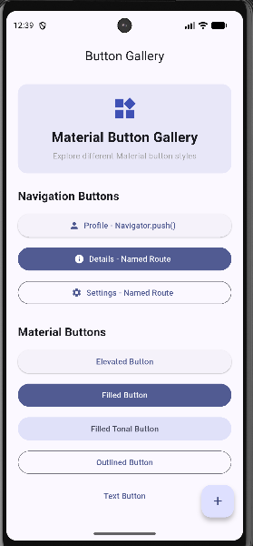
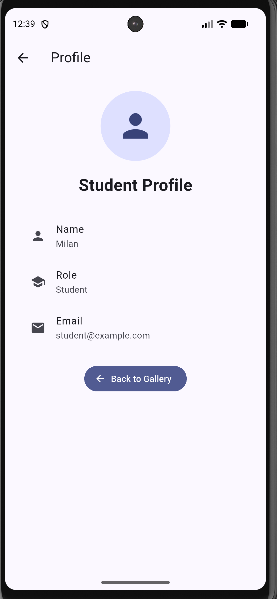
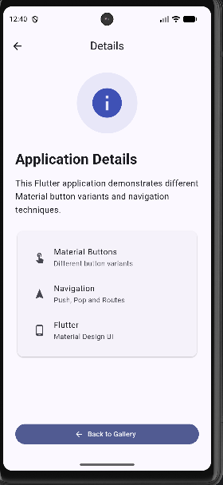
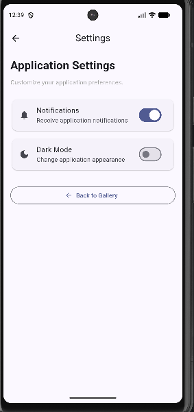

# Flutter Buttons & Navigation

A Flutter application demonstrating different **Material Design button variants** and **navigation techniques** using Flutter's `Navigator` and named routes.

This project was developed as a practical assignment to demonstrate Material buttons, multiple screens, navigation, and a clean mobile UI.

---

## 📱 Project Overview

The application contains a **Button Gallery** where users can interact with different Material button styles.

It also demonstrates navigation between multiple screens using:

* `Navigator.push()`
* `Navigator.pop()`
* `Navigator.pushReplacement()`
* `Navigator.pushNamed()`
* Named routes

---

## 🎯 Features

### Material Buttons

The Button Gallery contains:

* Elevated Button
* Filled Button
* Filled Tonal Button
* Outlined Button
* Text Button
* Icon Button
* Floating Action Button
* Button with Icon
* Custom Styled Button

Each button performs a meaningful action when pressed.

---

## 📱 Application Screens

### 1. Login Screen

The application starts with a Login screen containing:

* Email field
* Password field
* Login button

The Login button uses:

```dart
Navigator.pushReplacementNamed(
  context,
  '/buttons',
);
```

This removes the Login screen from the navigation stack.

---

### 2. Button Gallery

The Button Gallery is the main screen of the application.

It contains the different Material button variants and navigation buttons for:

* Profile
* Details
* Settings

It also contains a Floating Action Button.

---

### 3. Profile Screen

The Profile screen displays:

* Name
* Role
* Email
* Profile icon
* Edit Profile button
* Back button

The Back button demonstrates:

```dart
Navigator.pop(context);
```

---

### 4. Details Screen

The Details screen provides information about the application and demonstrates returning to the Button Gallery using:

```dart
Navigator.pop(context);
```

---

### 5. Settings Screen

The Settings screen contains simple application settings such as:

* Notifications
* Dark Mode

It also provides a Back button.

---

## 🔀 Navigation Techniques

### Navigator.push()

Used to open a new screen while keeping the current screen in the navigation stack.

Example:

```dart
Navigator.push(
  context,
  MaterialPageRoute(
    builder: (context) => const ProfileScreen(),
  ),
);
```

---

### Navigator.pop()

Used to return to the previous screen.

Example:

```dart
Navigator.pop(context);
```

---

### Navigator.pushReplacement()

Used for the Login → Button Gallery flow.

Example:

```dart
Navigator.pushReplacementNamed(
  context,
  '/buttons',
);
```

The Login screen is removed from the navigation stack, so pressing Back does not return to Login.

---

### Named Routes

The application defines routes inside `MaterialApp`:

```dart
routes: {
  '/': (context) => const LoginScreen(),
  '/buttons': (context) => const ButtonGallery(),
  '/profile': (context) => const ProfileScreen(),
  '/details': (context) => const DetailsScreen(),
  '/settings': (context) => const SettingsScreen(),
},
```

Named routes are then used with:

```dart
Navigator.pushNamed(
  context,
  '/details',
);
```

---

## 🗂️ Project Structure

```text
flutter_buttons_navigation/
│
├── lib/
│   ├── main.dart
│   │
│   └── screens/
│       ├── login_screen.dart
│       ├── button_gallery.dart
│       ├── profile_screen.dart
│       ├── details_screen.dart
│       └── settings_screen.dart
│
├── screenshots/
│   ├── login.png
│   ├── button_gallery.png
│   ├── profile.png
│   ├── details.png
│   └── settings.png
│
├── android/
├── ios/
├── web/
├── test/
├── pubspec.yaml
├── analysis_options.yaml
└── README.md
```

---

## 🛠️ Technologies Used

* Flutter
* Dart
* Material Design
* Android Studio
* Flutter Navigator
* Named Routes

---

## ▶️ How to Run

### 1. Clone the repository

```bash
git clone YOUR_GITHUB_REPOSITORY_URL
```

### 2. Open the project

Open the project in Android Studio or Visual Studio Code.

### 3. Install dependencies

Run:

```bash
flutter pub get
```

### 4. Check Flutter installation

```bash
flutter doctor
```

### 5. Run the application

Connect an Android device or start an Android emulator and run:

```bash
flutter run
```

---

## 📸 Screenshots

### Login Screen


### Button Gallery



### Profile Screen



### Details Screen



### Settings Screen




## 👨‍💻 Author

**Sagun Shakya**

Flutter Practical Assignment

---

## 📄 License

This project was created for educational and academic purposes.
